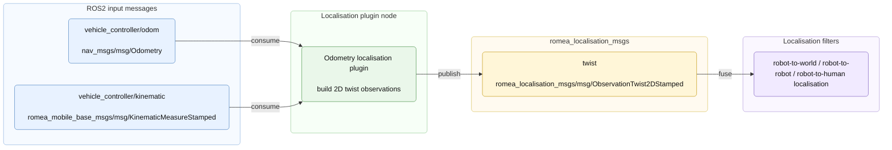

# romea_localisation_odo_plugin

`romea_localisation_odo_plugin` provides a ROS2 localisation plugin node that converts mobile base controller feedback into `romea_localisation_msgs` twist observations.

The plugin can consume either standard odometry messages or ROMEA mobile base kinematic measurements. It publishes a planar twist observation that can be fused by localisation filters.

## 1) Concept

The odometry localisation plugin is an observation producer. It does not estimate the robot pose by itself. It converts controller feedback into a 2D twist observation.



Only one controller feedback source is used at runtime. The source is selected with the `controller_topic` parameter.

## 2) Provided Plugin

| Executable | Component plugin |
| --- | --- |
| `odo_localisation_plugin_node` | `romea::ros2::localisation::OdoPlugin` |

## 3) Input Topics

| Topic | Type | Use |
| --- | --- | --- |
| `vehicle_controller/odom` | `nav_msgs/msg/Odometry` | Standard odometry feedback, selected with `controller_topic: odom` |
| `vehicle_controller/kinematic` | `romea_mobile_base_msgs/msg/KinematicMeasureStamped` | ROMEA mobile base kinematic feedback, selected with `controller_topic: kinematic` |

The `kinematic` source is preferred when available because it is produced by ROMEA mobile base controllers and is intended to carry kinematic measurements with consistent uncertainty information.

## 4) Output Topics

| Topic | Type | Description |
| --- | --- | --- |
| `twist` | `romea_localisation_msgs/msg/ObservationTwist2DStamped` | Planar twist observation with covariance |

The observation contains longitudinal speed, lateral speed and yaw angular speed.

## 5) Parameters

| Parameter | Type | Default | Description |
| --- | --- | --- | --- |
| `controller_topic` | string | `kinematic` | Controller feedback source. Accepted values are `odom` and `kinematic` |
| `restamping` | bool | `false` | If true, observations are stamped with the node clock instead of the input message stamp |

## 6) Configuration and Run

Run the plugin with:

```bash
ros2 run romea_localisation_odo_plugin odo_localisation_plugin_node \
  --ros-args --params-file path/to/odo_localisation_plugin.yaml
```

Example parameter file using the ROMEA kinematic feedback:

```yaml
odo_localisation_plugin:
  ros__parameters:
    controller_topic: kinematic
    restamping: false
```

Example parameter file using standard odometry feedback:

```yaml
odo_localisation_plugin:
  ros__parameters:
    controller_topic: odom
    restamping: false
```

## License

This project is released under the Apache License 2.0. See the `LICENSE` file for details.

## Authors

This package was developed by **Jean Laneurit**.
